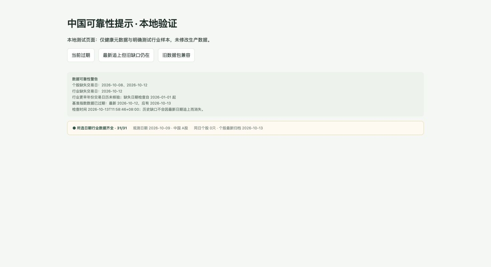
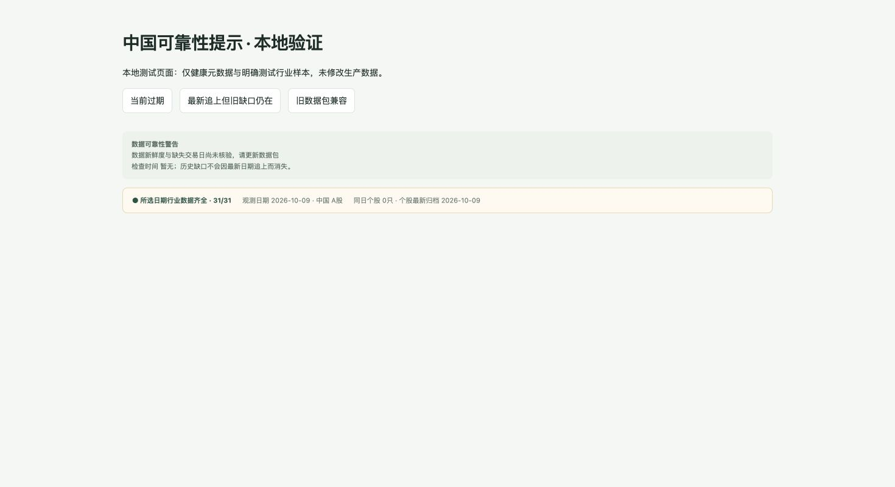

# 中国看板可靠性修复：收尾验收

核验日期：2026-10-13。仅代码审阅、测试与只读状态核验；未合并、部署、写入历史回填数据或改变生产调度。本报告不包含原始行情、完整成员名单、密文、密钥或私有日志。

## 可审阅改动

- [数据仓库 Draft PR #5](https://github.com/hatorinaoki0527-arch/industry-dashboard-data/pull/5)：最终提交 `dbd2ca34389f53e7d1623e59d688707a5295af6b`。
- [看板 Draft PR #1](https://github.com/hatorinaoki0527-arch/industry-dashboard/pull/1)：本报告、测试和截图随该 Draft PR 提交；精确最终 SHA 可从该 PR 的提交页核对，正文不嵌入自身提交 SHA。

后端分别输出个股、行业和基准指数的最新日期、缺失交易日、检查起点与日历范围；导出时重新只读检查为 `cnAutoHealth`。前端对最新数据与历史缺口分别提示，31/31明确只说明所选日期覆盖。检查结果包含在原加密数据包中。

## 精确测试与 CI

| 环境 / 提交 | 全量测试 | 结论 |
| --- | --- | --- |
| 未修改数据基线 `e5f348ee97c65f4ccad6b84c32989b9a697c58fe`，本机 Python 3.9.6 | 109项，404/503两个子场景失败 | 与当前分支同因 |
| 最终数据提交 `dbd2ca34389f53e7d1623e59d688707a5295af6b`，本机 Python 3.9.6 | 113项，同样两个子场景失败 | 非规定解释器行为差异 |
| 基线对应源代码 `4e71a4be77afef6f8095fa0aefee0cb2d44d851c`，远端 Python 3.12.15 | 109/109通过 | 到e5f348ee仅数据归档改变，Python代码、测试、工作流无差异 |
| 最终数据提交，远端 Python 3.12.15 | **113/113通过** | [精确提交CI](https://github.com/hatorinaoki0527-arch/industry-dashboard-data/actions/runs/38345144116) |
| 最终看板分支，本机 Node 24.21.0 | **46/46通过** | `node --test tests/*.test.cjs`；没有为审阅分支配置远端CI |

本机最终数据分支的中国相关43/43、导出4/4通过；两个仓库 `git diff --check`、前端 `node --check app.js` 均通过。本机未发现现成Python3.12，未安装解释器或改变系统设置。规定环境的全量测试由精确提交远端CI完成。

美国测试失败原因已经直接复现：测试人为构造 `HTTPError(..., fp=None)`，Python3.9的上下文管理器访问 `self.fp.closed` 引发 `AttributeError`，因此第一次请求就终止，断言期望的三次重试未发生。Python3.12构造器将None替换成 `BytesIO`，两种HTTP状态测试均通过。参见 [CPython 3.9源码](https://github.com/python/cpython/blob/3.9/Lib/urllib/error.py) 与 [CPython 3.12源码](https://github.com/python/cpython/blob/3.12/Lib/urllib/error.py)。这不是网络依赖，也不是本次引入的美国回归；美国实现和测试没有改动。

远端CI整体仍为FAILURE：`tests` SUCCESS、`us-source-probe` SUCCESS、`source-probe` FAILURE。中国source-probe的官方bulk实际取得50行（到10月12日），单个801010 history取得6469行（到10月12日）；失败发生在恢复探测要求整体 `healthy` 的断言，当前 `stocksStale=true`、`pending=[]`，未尝试行业补取。代码中的整体健康要求早于本次修复即存在；未为通过CI而隐藏这个真实数据问题。这项红灯不能解释为单元测试失败或行情接口不可用。

## 边界复核

- 日历采用[上交所2026年休市公告](https://www.sse.com.cn/disclosure/announcement/general/c/c_20251222_10802507.shtml)。10月1日至7日休市，10月8日恢复交易；周末（含10月10日）排除。前后端新增国庆边界测试通过。
- 新鲜度沿用北京时间19:00宽限，18:59不会过早标记当日未发布数据；缓存跨过宽限后重新计算。未知年份明确不宣称新鲜度已核验。
- 每类数据从自己的首个保留归档起算，不将上线前全部交易日误报成缺口。个股首档9月18日，因此10月8日位于合理检查范围；行业档案更早，2026年前日历范围明确未核验，2026缺日仍检查；基准从自己的首档起算。
- 缺日与最新日期分开计算：10月13日有新档案，10月12日历史缺口仍保留。进入2027等未核验年份也继续显示已核验2026缺口，不伪造2027日历。
- 旧前端可忽略新增健康字段；新前端遇到旧数据包显示“尚未核验”。查看历史日期不会清除全局警告，不补造日线占位数值，也不扩大自动回填范围。
- 恢复工作流只增加cn-market只读checkout以正确核验基准，未改变触发器、cron、生产采集窗口或快照日期保护。

## 用户 Mac 浏览器本地验证

使用用户Mac的Chrome，打开仅绑定127.0.0.1的本地测试页面。页面调用最终实际 `cnUpdateStatus` 函数与原有CSS，使用健康元数据和明确标识的合成行业行，验证当前过期、最新追上、旧包三种状态。没有解锁生产网站或执行实际发布，因此本验证不代表生产上线验收。

最新追上后，保留历史观测日期，并继续显示旧缺口：

旧包兼容明确显示尚未核验：

## 历史恢复限制与最小上线步骤

本机31个申万历史请求返回HTTP508，但远端至少一个官方历史接口和bulk已可读取到10月12日，因此不能认定上游全局故障。尚未取得全部31行业同日可复核源记录及昨收/涨跌语义证据。Tencent仅两只试验股票取得真实日期raw day，支持样本单位转换及价格比对；不能据此宣称完整个股历史、历史成员覆盖或除权日涨跌可恢复。调度延迟根因仍未知。

最小需要用户另行批准的上线范围：审阅并接受上述已明确的数据缺口/来源探测红灯后，合并两个Draft PR，再在私有数据仓库执行一次 `publish_only=true` 发布与实际页面验收。历史回填、生产调度调整及美国10月5日缺口均不包含在这项批准内。当前未执行上述步骤。
